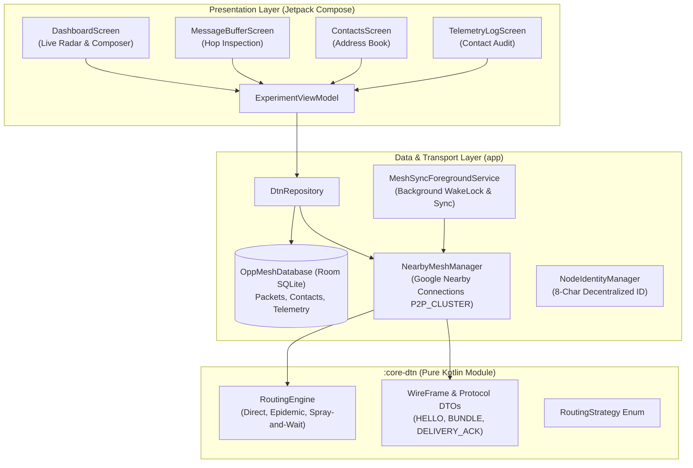
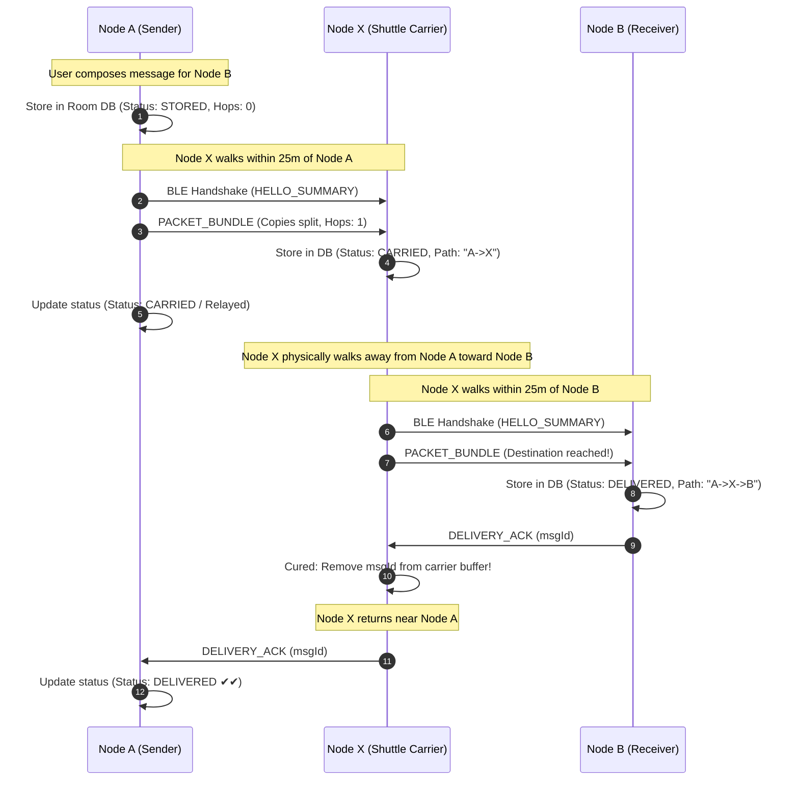

# OppMesh Mobile Application: Developer Documentation & Architecture Guide

Welcome to the **OppMesh** Android Developer Documentation. OppMesh is a decentralized, zero-infrastructure Opportunistic Delay-Tolerant Network (DTN) mobile application. It enables smartphones to communicate, route messages, and exchange files (up to 20MB) entirely peer-to-peer using short-range radio (Bluetooth Low Energy and Wi-Fi Direct) without internet, cellular connectivity, or central servers.

---

## 1. System Architecture Overview

The codebase is engineered around **Clean Architecture** principles and split into distinct modular layers:



### Module Breakdown
* **`:core-dtn`**: A pure Kotlin module with **zero Android dependencies**. Contains routing algorithms, packet encapsulation, and wire protocol definitions. Can be compiled and unit-tested independently on any JVM.
* **`:app`**: The Android application module containing the Jetpack Compose UI, Room SQLite database, Android 14+ background services, file utilities, and the Google Nearby Connections implementation.

---

## 2. Core Subsystems & Code Implementation

### 2.1 Node Identity Management
* **File**: `app/src/main/kotlin/com/oppmesh/dtn/util/NodeIdentityManager.kt`
* **Function**: Generates and persists a unique, decentralized 8-alphanumeric Node ID (e.g. `A7B2C9F4`) upon first launch using `UUID.randomUUID()`.
* **Storage**: Android `SharedPreferences` (`oppmesh_identity_prefs`).
* **Design Rationale**: Eliminates the need for manual device pairing or pre-configured node IDs. Users can view their ID on the dashboard and share it with peers.

### 2.2 Routing Engine (`:core-dtn`)
* **File**: `core-dtn/src/main/kotlin/com/oppmesh/dtn/domain/routing/RoutingEngine.kt`
* **Interface**: Implements `selectPacketsForPeer()`, which evaluates a local packet collection against a newly encountered peer's known and delivered packet sets:

```kotlin
fun selectPacketsForPeer(
    localPackets: Collection<DtnPacketHolder>,
    peerNodeId: String,
    peerKnownPacketIds: Set<String>,
    peerDeliveredPacketIds: Set<String>,
    currentEpochMs: Long
): List<OutgoingPacketSelection>
```

#### Supported Routing Strategies:
1. **Direct Delivery (`RoutingStrategy.DIRECT_DELIVERY`)**:
   * Packets are only forwarded when `peerNodeId == packet.destinationNodeId`.
   * Never replicates to intermediate relays (minimal transmission overhead).
2. **Epidemic Routing (`RoutingStrategy.EPIDEMIC`)**:
   * Full store-carry-forward flood.
   * If peer has not seen the packet and it has not been cured/delivered, forward a copy.
   * Delivers with lowest delay and highest resilience at the expense of transmission overhead.
3. **Binary Spray-and-Wait (`RoutingStrategy.SPRAY_AND_WAIT`)**:
   * **Spray Phase**: When `sprayCopiesRemaining > 1`, the sender splits its remaining copies: gives $\lfloor L / 2 \rfloor$ copies to the intermediate peer and retains $\lceil L / 2 \rceil$ copies.
   * **Wait Phase**: When `sprayCopiesRemaining == 1`, the node will **only** deliver directly to the final destination node.
   * Delivers near-Epidemic delay while strictly bounding network overhead.

### 2.3 Peer-to-Peer Mesh Transport
* **File**: `app/src/main/kotlin/com/oppmesh/dtn/data/nearby/NearbyMeshManager.kt`
* **Underlying Protocol**: Google Nearby Connections API (`Strategy.P2P_CLUSTER`) over Bluetooth Low Energy (BLE), Wi-Fi Direct, and Wi-Fi Aware.

#### Fast Opportunistic Discovery Duty Cycle
Opportunistic encounters in real life can last only 10–30 seconds. To maximize discovery and avoid deadlocks:
1. **Simultaneous Dual-Role**: Devices advertise and discover concurrently.
2. **Deterministic Tie-Break Leadership**: When two devices discover each other simultaneously, the node with the lexicographically smaller ID initiates the connection (`localNodeId < peerNodeId`), preventing connection collisions.
3. **Rapid Fallback Watchdog (3s / 15s)**: If a connection handshake does not finalize within 3 seconds, the lock is released. A 15-second discovery cycle periodically restarts discovery to unstick stale Android BLE caches.
4. **Periodic Contact Re-Sync (4s)**: While two devices remain continuously in range, a 4-second ticker periodically checks for newly arrived or generated bundles and forwards them immediately.

#### Wire Protocol Frame Types
Defined in `core-dtn/src/main/kotlin/com/oppmesh/dtn/domain/model/WireFrame.kt`:
* **`HELLO_SUMMARY`**: Exchanged immediately upon connection. Contains lists of `knownPacketIds` and `deliveredPacketIds`.
* **`PACKET_BUNDLE`**: Transports packet metadata, routing state, hop count, hop path CSV, and text payload.
* **`DELIVERY_ACK`**: Propagates delivered packet IDs back through intermediate nodes to purge buffered copies and stop redundant flooding.

### 2.4 Large File Transfer (Up to 20MB)
* **File**: `app/src/main/kotlin/com/oppmesh/dtn/util/FileUtils.kt`
* **Payload Type**: Google Nearby Connections `Payload.Type.FILE`.
* **Flow**:
  1. File is selected via Android Storage Access Framework (`ActivityResultContracts.GetContent`).
  2. Local file is copied to app cache (`/data/user/0/com.oppmesh.dtn/cache/attachments/`).
  3. A `PACKET_BUNDLE` is sent first containing metadata (`fileName`, `fileSizeBytes`, `filePayloadId`).
  4. The file payload stream is transmitted asynchronously.
  5. The receiving node maps the incoming `Payload.Type.FILE` ID to the pending bundle, stores the file into internal storage, and updates Room SQLite with the absolute file path.

### 2.5 Local Persistence (Room SQLite)
* **Database**: `app/src/main/kotlin/com/oppmesh/dtn/data/local/OppMeshDatabase.kt`
* **Entities**:
  * `PacketEntity`: Stores messages, status (`STORED`, `CARRIED`, `DELIVERED`, `EXPIRED`), copies, hop path history (`NODE-A -> NODE-X -> NODE-B`), and file paths.
  * `ContactEntity`: Contact book storing peer IDs with user-defined friendly display names.
  * `ContactLogEntity`: Audit log of peer encounters, duration, RSSI, and packet exchange counts.

### 2.6 Background Execution & WakeLock
* **File**: `app/src/main/kotlin/com/oppmesh/dtn/service/MeshSyncForegroundService.kt`
* **Type**: Android Foreground Service with type `connectedDevice`.
* **Features**:
  * Displays a persistent status notification showing current node ID and active peer count.
  * Holds a partial `WakeLock` to keep the CPU active for BLE scanning and opportunistic data transfers when the screen is turned off.

---

## 3. Protocol Flow & Message Lifecycles

### 3.1 Store-Carry-Forward 3-Node Hop Lifecycle



---

## 4. UI Layer & Compose Screens

| Screen | File | Primary Responsibility |
| :--- | :--- | :--- |
| **Dashboard** | `app/src/main/kotlin/com/oppmesh/dtn/ui/DashboardScreen.kt` | Displays own 8-character ID, live radar of nearby connected nodes, quick message composer with strategy picker (`DIRECT`, `EPIDEMIC`, `SPRAY_WAIT`), contact selector, and file attachment picker. |
| **Message Buffer** | `app/src/main/kotlin/com/oppmesh/dtn/ui/MessageBufferScreen.kt` | Real-time packet inspector showing status badge (`STORED`, `CARRIED`, `DELIVERED`), hop progression path, copies remaining, and attachment status. |
| **Contacts** | `app/src/main/kotlin/com/oppmesh/dtn/ui/ContactsScreen.kt` | Address book allowing users to save friendly names for peer 8-character IDs, add discovered nodes with 1 click, and trigger direct messaging. |
| **Telemetry Log** | `app/src/main/kotlin/com/oppmesh/dtn/ui/TelemetryLogScreen.kt` | Detailed protocol audit log showing connection timestamps, endpoints, duration, and packet exchange tallies. |

---

## 5. Build, Installation & Permissions

### 5.1 Prerequisites
* Android Studio Iguana (2023.2.1) or newer
* Android SDK 34 (UpsideDownCake)
* Minimum SDK: Android 8.0 (API Level 26)
* JDK 17

### 5.2 Build Commands
```bash
# Build Debug APK
./gradlew :app:assembleDebug

# Run Unit Tests (Domain layer & Routing tests)
./gradlew :core-dtn:test

# Install onto connected phone via ADB
adb install -r app/build/outputs/apk/debug/app-debug.apk
```

### 5.3 Required Android Permissions
Configured in `app/src/main/AndroidManifest.xml`:
* `BLUETOOTH_SCAN`, `BLUETOOTH_ADVERTISE`, `BLUETOOTH_CONNECT` (`neverForLocation` flag where applicable)
* `ACCESS_FINE_LOCATION` and `ACCESS_COARSE_LOCATION` (Required by Android 11 and below for BLE beaconing)
* `NEARBY_WIFI_DEVICES` (Android 13+ Wi-Fi Direct / Aware discovery)
* `POST_NOTIFICATIONS` (Android 13+ Foreground Service status bar notification)
* `FOREGROUND_SERVICE` and `FOREGROUND_SERVICE_CONNECTED_DEVICE` (Android 14+)
* `WAKE_LOCK` (Prevents CPU sleep during packet transfer)

---

## 6. How to Conduct a Multi-Device Field Test

1. **Install on 3 Physical Android Phones**:
   * Phone 1 (`Node A` - Sender)
   * Phone 2 (`Node X` - Relay / Shuttle Carrier)
   * Phone 3 (`Node B` - Receiver)
2. **Setup Initial Contacts**:
   * Open the app on Phone 3. Note down its 8-character ID (shown at top of Dashboard).
   * On Phone 1, open **Contacts** tab, click **+ Add Contact**, and enter Phone 3's ID and name `Receiver Phone`.
3. **Physical Hop Test**:
   1. Place Phone 1 in Room 1 and Phone 3 in Room 2 (at least 30 meters apart or separated by thick walls so they cannot connect directly).
   2. On Phone 1, compose a message (or attach an image file) for Phone 3 using `EPIDEMIC` or `SPRAY_AND_WAIT`. Click **Send**. Status shows **`STORED (Hops: 0)`**.
   3. Person carrying Phone 2 walks into Room 1 near Phone 1. Within 2–5 seconds, Phone 1's radar shows Phone 2 connected. The packet hops to Phone 2. Phone 1 updates to **`CARRIED`**.
   4. Person walks with Phone 2 to Room 2 near Phone 3.
   5. Within 2–5 seconds, Phone 2 and Phone 3 connect. The packet hops to Phone 3.
   6. Phone 3 displays the message and saves the file. Status on Phone 3 shows **`DELIVERED`** with hop path `A -> X -> B`.
   7. On return trip of Phone 2 near Phone 1, the delivery ACK returns, marking the message **`DELIVERED ✔✔`** on Phone 1!
